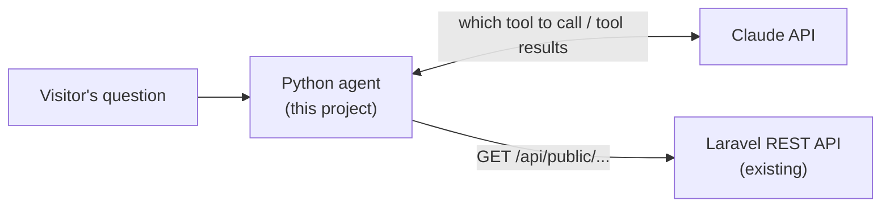

# muisca-agent

An AI agent for [Muisca Real Estate](https://muisca.ca). A visitor asks a question in plain
language, such as "3-bedroom houses for sale in Miami under 4 million", and the agent answers
with real listings by calling the site's existing Laravel REST API.

The Laravel application was not changed. The agent is a separate Python service that sits in
front of the API the website already uses.

## How it works



The model never calls the API itself. On each step it replies with either a final answer or a
request such as `search_properties(status_id="FSL", city_id=13)`. The agent validates the
request, calls Laravel, and sends the result back. This repeats until the model has an answer.

| Tool | What it does | Laravel endpoint |
| --- | --- | --- |
| `get_search_options` | Valid status codes, type codes and city ids | `property-statuses/lookup`, `property-types/lookup`, `cities-with-properties` |
| `search_properties` | Filtered, paginated search | `properties/search` |
| `get_property` | Full details of one listing | `properties/{id}` |
| `list_agents` | Agents and their contact details | `agents` |

Design choices:

- **Read-only.** Every tool is a GET on a public route. The agent cannot change data.
- **Small tool results.** HTML is stripped from descriptions and search results carry a short
  summary, so the model reads clean text and fewer tokens are spent.
- **Errors go back to the model.** A failed call returns a result marked `is_error`, and the
  model can correct its arguments or explain the problem.
- **Unknown filters are rejected.** Laravel ignores query parameters it doesn't know, which
  would silently return unfiltered results. The tool refuses them instead.
- **Bounded cost.** At most 8 model calls per question.

## Setup

Requires Python 3.10 or later (developed and tested on 3.13) and a [Claude API key](https://platform.claude.com/).

```bash
python3 -m venv .venv
source .venv/bin/activate
pip install -r requirements.txt
cp .env.example .env        # then edit .env: add your key and check the API URL
```

## Run

```bash
python -m muisca_agent "3-bedroom houses for sale in Miami"
python -m muisca_agent -v "who is the agent for PROP-001?"   # also shows tool calls and tokens
python -m muisca_agent                                       # interactive chat
```

As an HTTP service, for a chat widget:

```bash
uvicorn muisca_agent.server:app --port 8100

curl -X POST http://127.0.0.1:8100/chat \
  -H "Content-Type: application/json" \
  -d '{"message": "Any apartments for rent?"}'
```

`/chat` has no authentication or rate limiting. Each request spends API credits, so add both
before putting it on the internet.

## Test

```bash
pytest
```

The tests don't use the network or an API key. The Laravel API is replaced by saved responses
in `tests/fixtures`, and the model by a script of replies, which makes the loop's behaviour
(tool results, errors, the step limit) exact and repeatable.

## Configuration

| Variable | Default | Purpose |
| --- | --- | --- |
| `ANTHROPIC_API_KEY` | none | Claude API key. Required to run, not to test. |
| `MUISCA_API_URL` | `http://localhost:8000` | Base URL of the Laravel API |
| `ANTHROPIC_MODEL` | `claude-sonnet-5-5` | Model that answers |
| `CORS_ORIGINS` | none | Browser origins allowed to call `/chat`, comma-separated |

## Project layout

```
muisca_agent/muisca_api.py   REST client for the Laravel API; no AI code
muisca_agent/tools.py        Tool definitions sent to the model, and the code that runs them
muisca_agent/agent.py        The agent loop and the system prompt
muisca_agent/__main__.py     Command line
muisca_agent/server.py       FastAPI service with POST /chat
tests/                       pytest suite and saved API responses
```

## License

MIT
